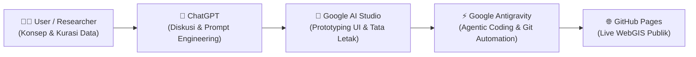
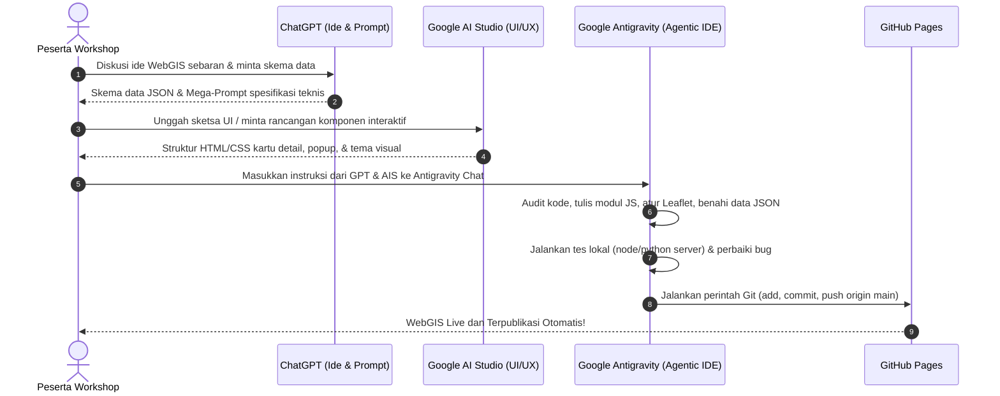
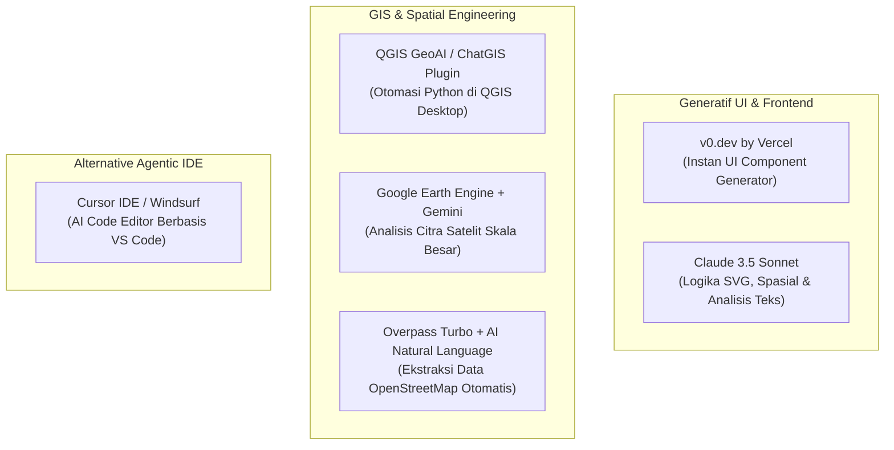

# MODUL WORKSHOP: PEMANFAATAN EKOSISTEM AI DALAM PENGEMBANGAN WEBGIS TEMATIK INTERAKTIF
*Dari Konseptualisasi Cerdas, Perancangan UI, hingga Publikasi Otomatis ke GitHub Pages*

---

## DAFTAR ISI
1. [Latar Belakang & Paradigma Baru Pengembangan GIS](#1-latar-belakang--paradigma-baru-pengembangan-gis)
2. [Arsitektur Alur Kerja 3 Pilar AI (The 3-Pillar AI Workflow)](#2-arsitektur-alur-kerja-3-pilar-ai-the-3-pillar-ai-workflow)
3. [Panduan Langkah demi Langkah (Hands-on Step-by-Step)](#3-panduan-langkah-demi-langkah-hands-on-step-by-step)
   - [Fase 1: Konseptualisasi & Prompt Engineering bersama ChatGPT](#fase-1-konseptualisasi--prompt-engineering-bersama-chatgpt)
   - [Fase 2: Perancangan UI/UX & Generative Interface di Google AI Studio](#fase-2-perancangan-uiux--generative-interface-di-google-ai-studio)
   - [Fase 3: Pemrograman Otonom & Eksekusi Spasial di Google Antigravity](#fase-3-pemrograman-otonom--eksekusi-spasial-di-google-antigravity)
   - [Fase 4: Otomasi Publikasi & Sinkronisasi Git/GitHub](#fase-4-otomasi-publikasi--sinkronisasi-gitgithub)
4. [Studi Kasus Riil: WebGIS Atlas Sejarah Islam Nusantara](#4-studi-kasus-riil-webgis-atlas-sejarah-islam-nusantara)
5. [Rekomendasi Alat AI Lain untuk Ekosistem Geospasial](#5-rekomendasi-alat-ai-lain-untuk-ekosistem-geospasial)
6. [Best Practices, Etika Data & Mitigasi Halusinasi AI](#6-best-practices-etika-data--mitigasi-halusinasi-ai)
7. [Checklist & Panduan Instruktur Workshop](#7-checklist--panduan-instruktur-workshop)

---

## 1. LATAR BELAKANG & PARADIGMA BARU PENGEMBANGAN GIS

Secara konvensional, pembuatan aplikasi WebGIS memerlukan penguasaan berbagai disiplin ilmu sekaligus:
- **Kartografi & GIS Desktop** (QGIS, ArcGIS, sistem proyeksi CRS, georeferensi).
- **Struktur Data Geospasial** (GeoJSON, TopoJSON, Shapefile, integrasi temporal/waktu).
- **Frontend Web Development** (HTML5, CSS modern, JavaScript asynchronous).
- **Library Pemetaan Web** (Leaflet, MapLibre, OpenLayers).
- **DevOps & Deployment** (Git, GitHub, hosting web).

Hadirnya **Generative AI** dan **Agentic AI Coding Assistant** tidak menghilangkan kebutuhan pemahaman spasial, melainkan mengubah peran pengembang dari *"penulis kode baris-demi-baris"* (*manual coder*) menjadi **"Arsitek Sistem & Kurator Data"** (*System Architect & Quality Assurer*).



---

## 2. ARSITEKTUR ALUR KERJA 3 PILAR AI (THE 3-PILLAR AI WORKFLOW)

Alur kerja workshop ini dirancang menggunakan 3 platform AI dengan peran spesifik tanpa tumpang tindih:

| Pilar AI | Peran Utama | Keunggulan Spesifik | Output yang Dihasilkan |
| :--- | :--- | :--- | :--- |
| **1. ChatGPT** (OpenAI) | *The Brain & Conceptualizer* | Penalaran konseptual, brainstorming historiografi/metodologi, formulasi skema basis data, dan generator prompt terstruktur. | Kerangka konsep, skema JSON, dan *Prompt Instruksi Utama*. |
| **2. Google AI Studio** (Gemini) | *The UI/UX Prototyper* | Pemrosesan multimodal (gambar/sketsa/referensi), eksplorasi desain komponen interaktif, palet warna, dan kartu responsif. | Mockup visual, tata letak CSS/HTML dasar, skema visual drawer & popup. |
| **3. Google Antigravity** | *The Autonomous Agent & Spatial Engineer* | Membaca seluruh file project, menulis kode, memvalidasi sintaks, menjalankan server lokal, menguji bug, dan mengeksekusi perintah terminal Git secara mandiri. | Kode aplikasi utuh (Leaflet WebGIS), perbaikan bug instan, dan auto-commit/push ke GitHub. |

---

## 3. PANDUAN LANGKAH DEMI LANGKAH (HANDS-ON STEP-BY-STEP)



---

### FASE 1: KONSEPTUALISASI & PROMPT ENGINEERING BERSAMA CHATGPT

#### Tujuan:
Mematangkan ide tematik, menentukan atribut geospasial, dan menyusun *Mega-Prompt* yang jelas untuk dieksekusi oleh agentic AI.

#### Pola Diskusi dengan ChatGPT:
1. **Brainstorming Topik & Batasan Ruang Lingkup:**
   Jelaskan pada ChatGPT apa tema sebaran yang ingin dipetakan (misal: situs sejarah, sebaran fasilitas publik, sebaran komoditas unggulan).
2. **Definisi Entitas & Skema Data:**
   Minta ChatGPT merumuskan struktur data JSON/GeoJSON yang modular.
3. **Penyusunan Mega-Prompt:**
   Minta ChatGPT menulis prompt teknis dengan instruksi gaya developer senior.

#### Template Prompt ChatGPT (Contoh):
```text
"Saya ingin membuat WebGIS interaktif menggunakan Leaflet.js untuk memetakan [TEMA SEBARAN, misal: Sebaran Kerajaan Islam & Situs Sejarah di Nusantara]. 

Tolong bertindak sebagai Senior GIS System Architect:
1. Buatkan skema struktur basis data JSON yang memisahkan antara entitas utama, linimasa peristiwa, dan situs peninggalan.
2. Jelaskan atribut apa saja yang wajib ada (koordinat CRS WGS84 lat-lng, periode tahun, historiografi, sumber akademik).
3. Setelah kita sepakati skemanya, tolong buatkan 'Master Prompt' lengkap dan detail yang siap saya kirimkan ke AI Coding Assistant (Antigravity) agar ia langsung membangun sistem WebGIS ini secara modular tanpa membuat dari nol."
```

---

### FASE 2: PERANCANGAN UI/UX & GENERATIVE INTERFACE DI GOOGLE AI STUDIO

#### Tujuan:
Mengeksplorasi antarmuka yang modern, estetis, dan ramah seluler (*mobile-responsive*) menggunakan model Gemini berkecepatan tinggi dengan konteks luas.

#### Langkah Pengerjaan:
1. Buka [Google AI Studio](https://aistudio.google.com/).
2. Pilih model terbaru (misal: `Gemini 1.5 Pro` atau `Gemini 2.0 Flash`).
3. **Eksplorasi Skema Visual Tematik:**
   * Masukkan konsep warna (misal: nuansa hijau zamrud nusantara `#0f4c3a`, emas `#d97706`, dan krem `#faf7f0`).
   * Tanyakan bagaimana layout terbaik untuk *Floating Time Series Bar*, *Collapsible Detail Drawer*, dan *Filter Chips*.
4. **Input Sketsa / Screenshot:**
   * Anda bisa mengunggah tangkapan layar peta atau sketsa coretan tangan di kertas, lalu minta AI Studio:
     *"Ubah sketsa panel kontrol ini menjadi markup HTML flexbox/grid yang responsif untuk layar handphone (viewport 360-400px)."*
5. Simpan rekomendasi struktur CSS/HTML untuk digabungkan ke prompt Antigravity.

---

### FASE 3: PEMROGRAMAN OTONOM & EKSEKUSI SPASIAL DI GOOGLE ANTIGRAVITY

#### Apa itu Antigravity?
Antigravity adalah **Agentic AI Coding Assistant** tingkat lanjut. Berbeda dari chat AI biasa yang hanya memberikan cuplikan kode di layar, Antigravity dapat:
- Menjelajahi dan membaca seluruh file di workspace proyek.
- Mengedit, menambahkan, dan menghapus file secara langsung.
- Menjalankan perintah terminal (PowerShell, Node.js, Python, Git) tanpa pengguna harus menyalin kode manual.
- Mendeteksi error sintaks atau layout secara otomatis dan langsung memperbaikinya.

#### Langkah Eksekusi di Antigravity:
1. Buka workspace proyek WebGIS di Antigravity.
2. Salin dan kirimkan *Master Prompt* dari ChatGPT serta arahan visual dari AI Studio.
3. Biarkan Antigravity melakukan audit kode, membangun logika spasial Leaflet, membagi modul JS (`map.js`, `timeline.js`, `detail.js`, `filters.js`), dan memformat GeoJSON.
4. **Review & Iterasi Cepat:**
   Jika ada fitur kurang pas (misal: *filter kepulauan kurang responsif*, *perlu foto dokumentasi cagar budaya*), cukup berikan feedback ringkas dalam bahasa manusia:
   > *"Tolong tambahkan foto dokumentasi masjid dan makam bersejarah di popup dan drawer ketika diklik, ambil dari sumber legal seperti Wikimedia Commons, dan pastikan tidak bikin berat (gunakan lazy loading)."*

---

### FASE 4: OTOMASI PUBLIKASI & SINKRONISASI GIT/GITHUB

Salah satu fitur paling unggul dari alur kerja ini adalah **Anda tidak perlu membuka terminal atau aplikasi Git terpisah**.

#### Alur Publikasi Otomatis via Antigravity:
1. Buat repositori kosong di GitHub (misal: `nama-user/webgis-tematik`).
2. Minta Antigravity melakukan konfigurasi remote dan publish:
   > *"Tolong bantu inisialisasi Git, sambungkan ke repositori https://github.com/username/webgis-tematik.git, buat commit pertama, dan push ke branch main."*
3. Antigravity akan mengeksekusi rangkaian perintah terminal:
   ```powershell
   git add .
   git commit -m "feat: initial release thematic WebGIS"
   git push origin main
   ```
4. **Aktifkan GitHub Pages (Sekali Saja di Web GitHub):**
   * Buka Repositori di GitHub &rarr; Tab **Settings** &rarr; Menu **Pages**.
   * Pada bagian **Branch**, pilih `main` dan folder `/ (root)`, lalu klik **Save**.
   * Dalam 1–2 menit, WebGIS Anda live di URL: `https://username.github.io/webgis-tematik/`.
5. **Auto-Update Setiap Kali Ada Perubahan:**
   Setiap kali Anda meminta Antigravity menambah data atau memperbaiki tampilan, cukup katakan:
   > *"Bagus, tolong langsung commit dan push perubahan terbaru ke GitHub."*
   WebGIS online akan otomatis terbarui secara instan!

---

## 4. STUDI KASUS RIIL: WEBGIS ATLAS SEJARAH ISLAM NUSANTARA

Sebagai contoh nyata yang dapat dipresentasikan dalam workshop, proyek WebGIS ini mengintegrasikan:
1. **Pemetaan Spasial Temporal:**
   * Slider linimasa dinamis dari abad ke-12 M hingga kemerdekaan NKRI (1945 M).
   * Poligon wilayah kekuasaan yang berevolusi sesuai tahun historis berdasarkan atlas Robert Cribb.
2. **Layer Multi-Kategori:**
   * Titik istana/keraton kesultanan, masjid kuno, makam bersejarah, benteng pertahanan, dan bandar niaga.
3. **Detail Drawer Kaya Data (Rich Media):**
   * Foto dokumentasi beresolusi tinggi dengan lisensi CC-BY-SA Wikimedia Commons.
   * Narasi arsitektur, historiografi kepastian data, dan referensi akademik otoritatif.
4. **Desain Mobile-First:**
   * Bottom sheet interaktif, zoom control yang tidak tertutup, tombol reset kompas, dan pencarian universal lintas masa.

---

## 5. REKOMENDASI ALAT AI LAIN UNTUK EKOSISTEM GEOSPASIAL

Selain kombinasi **ChatGPT + Google AI Studio + Antigravity**, berikut beberapa AI alternatif yang sangat direkomendasikan untuk materi tambahan workshop:



### 1. Claude 3.5 Sonnet (Anthropic)
- **Kelebihan Spesifik:** Model AI terbaik saat ini untuk analisis kode spasial kompleks, manipulasi vektor SVG, dan pembacaan naskah kuno/transkripsi teks historis untuk diekstrak menjadi koordinat toponimi.
- **Kasus Penggunaan:** Sangat tepat untuk mengekstrak tabel daftar raja, tahun bertahta, dan koordinat dari file PDF jurnal sejarah menjadi format JSON siap pakai.

### 2. v0.dev (by Vercel)
- **Kelebihan Spesifik:** Menghasilkan antarmuka web interaktif berbasis prompt teks dalam hitungan detik (menggunakan Tailwind CSS dan komponen React/HTML).
- **Kasus Penggunaan:** Jika peserta workshop ingin mendesain purwarupa dashboard GIS sebelum digabungkan ke Leaflet.

### 3. QGIS AI / GeoAI Plugins
- **Kelebihan Spesifik:** Integrasi LLM langsung di dalam software QGIS Desktop.
- **Kasus Penggunaan:** Membantu pengguna menulis skrip PyQGIS untuk otomatisasi pemotongan buffer, georeferensi batch raster peta kuno, dan kalkulasi luas poligon.

### 4. Overpass Turbo dengan Bantuan AI
- **Kelebihan Spesifik:** Mengubah bahasa manusia menjadi query Overpass QL untuk mengunduh data batas wilayah, masjid, sungai, atau jalan dari OpenStreetMap secara gratis dan legal.

---

## 6. BEST PRACTICES, ETIKA DATA & MITIGASI HALUSINASI AI

> [!WARNING]
> **Perangkap Terbesar Pengembang WebGIS Berbasis AI:**
> AI sering melakukan *hallucination* (mengarang fakta) jika diminta menentukan koordinat geografis atau batas wilayah politik masa lalu yang tidak pasti.

### Prinsip Integritas Spasial-Sejarah:
1. **Hindari Batas Imajiner (No Artificial Polygons):**
   * Jika tidak ada peta arsip resmi yang menggambarkan batas kerajaan, jangan gunakan *convex hull* atau *buffer* otomatis untuk mengklaim wilayah kekuasaan administratif.
   * Gunakan konsep *Mandala* / *Sphere of Influence* (titik pusat kekuasaan + label daerah pengaruh).
2. **Kewajiban Referensi Sumber Akademik:**
   * Setiap titik dan poligon harus memiliki atribut `source_title`, `source_year`, dan `confidence_level` (Tinggi / Sedang / Interpretatif).
3. **Lisensi Terbuka & Atribusi Legal:**
   * Utamakan foto dokumentasi dari Wikimedia Commons, Tropenmuseum, Perpustakaan Nasional (Perpusnas), atau inventaris cagar budaya Kemendikbudristek dengan atribusi lisensi yang jelas.
4. **Optimasi Performa WebGIS (Anti-Lag):**
   * Selalu gunakan `loading="lazy"` pada elemen ``.
   * Simpan geometri poligon dalam format GeoJSON yang sudah disederhanakan (*simplified tolerance* $\approx 0.001^\circ$) agar ukuran berkas tidak membengkak di koneksi mobile.

---

## 7. CHECKLIST & PANDUAN INSTRUKTUR WORKSHOP

### Persiapan Peserta (Prerequisites):
- [ ] Akun GitHub aktif.
- [ ] Browser modern (Chrome, Edge, atau Firefox).
- [ ] Akses internet stabil.
- [ ] Akun ChatGPT (Free atau Plus) & akun Google AI Studio.
- [ ] Perangkat lunak editor / agentic assistant (Google Antigravity atau VS Code + Git).

### Alokasi Waktu Workshop (Contoh Sesi 3 Jam):
* **00:00 - 00:30 (30 Menit):** Teori Pengantar WebGIS & Demonstrasi Arsitektur 3 Pilar AI.
* **00:30 - 01:15 (45 Menit):** Sesi 1 - Konseptualisasi Topik & Pembuatan Skema Data di ChatGPT.
* **01:15 - 01:45 (30 Menit):** Sesi 2 - Eksplorasi Desain Komponen di Google AI Studio.
* **01:45 - 02:30 (45 Menit):** Sesi 3 - Hands-on Pemrograman Otomatis & Debugging di Antigravity.
* **02:30 - 03:00 (30 Menit):** Sesi 4 - Publikasi GitHub Pages, Pengujian di Smartphone, & Tanya Jawab.

---
*Modul ini disusun berdasarkan alur kerja riil produksi WebGIS Atlas Sejarah Islam Nusantara.*
