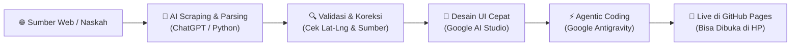
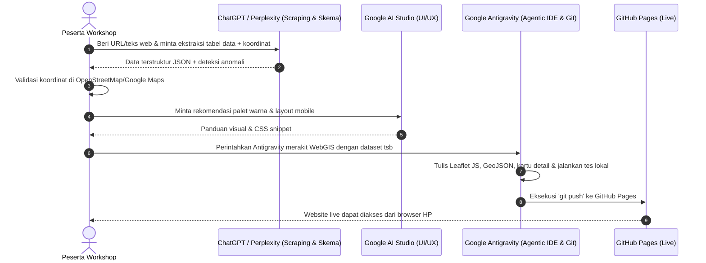
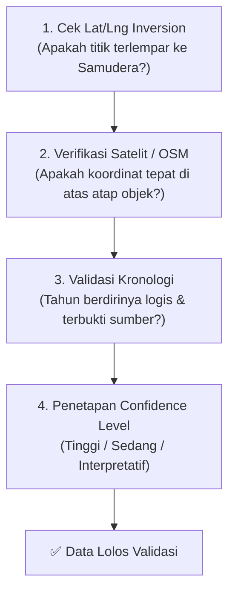

# MODUL WORKSHOP: PEMANFAATAN EKOSISTEM AI DALAM PENGEMBANGAN WEBGIS TEMATIK INTERAKTIF
*Dari Scraping Data, Validasi Geospasial, Prototyping UI, hingga Publikasi GitHub Pages (Durasi: 2 Jam)*

---

## DAFTAR ISI
1. [Latar Belakang & Paradigma Baru Pengembangan GIS](#1-latar-belakang--paradigma-baru-pengembangan-gis)
2. [Rundown Workshop Intensif 2 Jam (120 Menit)](#2-rundown-workshop-intensif-2-jam-120-menit)
3. [Arsitektur Alur Kerja 3 Pilar AI (The 3-Pillar AI Workflow)](#3-arsitektur-alur-kerja-3-pilar-ai-the-3-pillar-ai-workflow)
4. [Fase 1: AI Web Scraping & Ekstraksi Data Spasial](#fase-1-ai-web-scraping--ekstraksi-data-spasial)
5. [Fase 2: Koreksi & Pemeriksaan Keakuratan Data (Data Validation & Anti-Hallucination)](#fase-2-koreksi--pemeriksaan-keakuratan-data-data-validation--anti-hallucination)
6. [Fase 3: Panduan Melampirkan Dataset Mandiri Peserta (Untuk Ujian / Proyek Akhir)](#fase-3-panduan-melampirkan-dataset-mandiri-peserta-untuk-ujian--proyek-akhir)
7. [Fase 4: Perancangan UI/UX Cepat di Google AI Studio](#fase-4-perancangan-uiux-cepat-di-google-ai-studio)
8. [Fase 5: Eksekusi Kode Otonom di Google Antigravity & Debugging](#fase-5-eksekusi-kode-otonom-di-google-antigravity--debugging)
9. [Fase 6: Otomasi Publikasi & Hosting Gratis di GitHub Pages](#fase-6-otomasi-publikasi--hosting-gratis-di-github-pages)
10. [Rekomendasi Alat AI Lain & Rekapitulasi](#10-rekomendasi-alat-ai-lain--rekapitulasi)

---

## 1. LATAR BELAKANG & PARADIGMA BARU PENGEMBANGAN GIS

WebGIS tematik adalah instrumen penting dalam diseminasi informasi spasial, baik untuk penelitian akademik, pemetaan potensi wilayah, cagar budaya, maupun kebencanaan. 

Tantangan utama pembuat WebGIS pemula biasanya terletak pada:
1. Kesulitan mengumpulkan data sebaran yang berserak di web.
2. Risiko kesalahan/halusinasi koordinat geografis.
3. Kerumitan coding frontend dan peta interaktif.
4. Hambatan publikasi agar website bisa dibuka oleh orang lain tanpa biaya sewa server.

Melalui integrasi **AI Web Scraping + Data Validation + Agentic Coding (Antigravity) + GitHub Pages**, proses yang dulunya memakan waktu berminggu-minggu kini dapat diselesaikan secara terstruktur dan terverifikasi dalam **2 jam**.



---

## 2. RUNDOWN WORKSHOP INTENSIF 2 JAM (120 MENIT)

Jadwal disusun presisi dengan rasio 30% teori & konsep, 70% praktik langsung (*hands-on*):

| Waktu | Durasi | Agenda / Materi Utama | Output Peserta |
| :--- | :--- | :--- | :--- |
| **00:00 - 00:15** | 15 menit | **Pembukaan & Pengantar:** Paradigma AI dalam GIS dan pengenalan arsitektur 3 pilar. | Pemahaman alur kerja modern |
| **00:15 - 00:40** | 25 menit | **Sesi 1: Scraping Data & Konversi Format:** Mengambil data tabular/naskah web menjadi JSON spasial terstruktur. | File data mentah terekstraksi |
| **00:40 - 01:00** | 20 menit | **Sesi 2: Verifikasi & Koreksi Data:** Uji keakuratan koordinat WGS84, pencegahan *lat/lng flip*, dan format dataset mandiri peserta. | Dataset bersih & terverifikasi |
| **01:00 - 01:35** | 35 menit | **Sesi 3: Hands-on Antigravity (Coding WebGIS):** Integrasi Leaflet, poligon temporal, foto dokumentasi, dan mobile responsive. | WebGIS berjalan di local server |
| **01:35 - 01:50** | 15 menit | **Sesi 4: Publikasi Otomatis ke GitHub Pages:** Eksekusi `git push` via AI dan peluncuran website publik. | URL aktif WebGIS peserta |
| **01:50 - 02:00** | 10 menit | **Evaluasi Ujian & Penutupan:** Review proyek peserta dan sesi tanya jawab. | Penilaian hasil karya |

---

## 3. ARSITEKTUR ALUR KERJA 3 PILAR AI (THE 3-PILLAR AI WORKFLOW)



---

## 4. FASE 1: AI WEB SCRAPING & EKSTRAKSI DATA SPASIAL

Banyak data sejarah, potensi wilayah, atau objek wisata tersimpan dalam artikel web, Wikipedia, rilis berita, atau portal pemerintah yang tidak menyediakan tombol "Download Shapefile/GeoJSON".

### Metode A: AI Text/Table Parsing (Tanpa Koding)
Peserta dapat menyalin teks artikel/tabel panjang dari web, lalu meminta ChatGPT atau Gemini untuk melakukan *parsing*:

#### Contoh Prompt AI Scraping:
```text
"Tolong bertindak sebagai Data Extraction Specialist. 
Berikut adalah teks artikel berisi daftar 10 benteng bersejarah di Indonesia beserta keterangannya:
[TEMPELKAN TEKS / TABEL DARI SITUS WEB DI SINI]

Tugasmu:
1. Ekstrak entitas tersebut ke dalam format JSON array yang rapi.
2. Setiap objek wajib memiliki kunci: id, nama_objek, tipe, tahun_didirikan, nama_kota_kabupaten, latitude, longitude, deskripsi_ringkas, dan referensi_sumber.
3. Estimasi koordinat latitude dan longitude (CRS WGS84) berdasarkan pusat lokasi fisik benteng tersebut.
4. Tampilkan hasilnya dalam satu blok kode JSON yang valid tanpa teks pembuka berlebih."
```

### Metode B: Otomasi Skrip Python Scraping (Untuk Halaman Berulang)
Jika data berada di banyak halaman, minta AI membuatkan skrip Python ringkas dengan `BeautifulSoup` atau `requests`:
```python
# Contoh skrip scraping otomatis hasil arahan AI
import requests
from bs4 import BeautifulSoup
import json

url = "https://id.wikipedia.org/wiki/Daftar_masjid_kuno_di_Indonesia"
resp = requests.get(url)
soup = BeautifulSoup(resp.text, 'html.parser')
# AI membantu mengekstrak baris <tr> dan <td> menjadi list dictionary
```

---

## 5. FASE 2: KOREKSI & PEMERIKSAAN KEAKURATAN DATA (DATA VALIDATION & ANTI-HALLUCINATION)

> [!CAUTION]
> **Peringatan Kritis untuk Peserta Workshop:**
> AI sering melakukan halusinasi pada angka koordinat dan tahun! Koordinat yang diberikan AI **HARUS DIUJI** sebelum dimasukkan ke peta.

### Checklist Wajib Pemeriksaan Keakuratan Data:



1. **Pencegahan Lat/Lng Inversion (*Tertukar Lintang dan Bujur*):**
   * Wilayah Indonesia membentang di sekitar:
     * **Latitude (Lintang):** Antara $+6^\circ\text{ LU}$ (Sabang) hingga $-11^\circ\text{ LS}$ (Rote).
     * **Longitude (Bujur):** Antara $+95^\circ\text{ BT}$ hingga $+141^\circ\text{ BT}$.
   * *Jika latitude bernilai 110 dan longitude bernilai -7, maka koordinat tertukar! Titik akan terlempar ke kutub atau samudera antah berantah.*
2. **Koreksi Toponimi Kuno vs Modern:**
   * Nama tempat bersejarah seringkali berbeda dengan administrasi modern (misal: *Sunda Kelapa* $\rightarrow$ *Pelabuhan Sunda Kelapa, Jakarta Utara*; *Barus* $\rightarrow$ *Tapanuli Tengah*). Peserta harus memverifikasi bahwa titik mengacu pada lokasi cagar budaya sebenarnya, bukan hanya kantor kecamatan.
3. **Pemberian Skor Keyakinan (*Confidence Level*):**
   * **Tinggi:** Memiliki koordinat presisi dari registrasi Cagar Budaya Kemendikbudristek / BPCB / GPS lapangan.
   * **Sedang / Interpretatif:** Berdasarkan perkiraan teks babad/arsip kolonial tanpa sisa fondasi fisik yang utuh.

---

## 6. FASE 3: PANDUAN MELAMPIRKAN DATASET MANDIRI PESERTA (UNTUK UJIAN / PROYEK AKHIR)

Untuk keperluan ujian atau tugas mandiri workshop, peserta diwajibkan menyiapkan data tematik mereka sendiri (misal: sebaran kuliner lokal, sebaran puskesmas, sebaran peninggalan kolonial kota masing-masing).

### Format Standar Spreadsheet (Excel / Google Sheets / CSV):
Instruktur dapat membagikan format template CSV sederhana berikut kepada peserta:

| id | nama_objek | kategori | latitude | longitude | tahun_awal | tahun_akhir | deskripsi | foto_url | sumber_data |
| :--- | :--- | :--- | :--- | :--- | :--- | :--- | :--- | :--- | :--- |
| `obj-01` | Masjid Agung Demak | ibadah | -6.8946 | 110.6373 | 1479 | 9999 | Peninggalan Wali Songo | `https://...jpg` | BPCB Jateng |
| `obj-02` | Benteng Vredeburg | benteng | -7.8003 | 110.3662 | 1767 | 9999 | Benteng kolonial Yogya | `https://...jpg` | Kemendikbud |

### Cara Mengimpor Dataset Sendiri ke Antigravity:
Peserta cukup menyimpan file tabel tersebut sebagai `data/dataset_mandiri.csv` di folder proyek, lalu memberikan perintah ke Antigravity:
> *"Saya sudah melampirkan dataset saya di `data/dataset_mandiri.csv`. Tolong periksa validitas koordinatnya, konversikan menjadi format JSON/GeoJSON WGS84, dan integrasikan layer sebaran ini ke dalam WebGIS Leaflet kita lengkap dengan filter kategori dan popup foto."*

---

## 7. FASE 4: PERANCANGAN UI/UX CEPAT DI GOOGLE AI STUDIO

*(Waktu: 10–15 menit)*
1. Buka [Google AI Studio](https://aistudio.google.com/).
2. Tentukan identitas visual:
   * **Warna Utama:** Pilih warna sesuai tema (misal: Hijau hutan `#1b4332` untuk ekowisata, Biru bahari `#0077b6` untuk pesisir/maritim, Merah marun `#780000` untuk situs perjuangan).
3. Buat rancangan popup dan panel samping (*drawer*) yang ramah layar smartphone:
   * Header judul yang tidak terpotong.
   * Wadah foto dengan aspek rasio `16:9` atau `4:3`.
   * Label metadata ringkas (Tahun, Kategori, Status Cagar).

---

## 8. FASE 5: EKSEKUSI KODE OTONOM DI GOOGLE ANTIGRAVITY & DEBUGGING

*(Waktu: 30–35 menit)*
Peserta bekerja sama secara *pair programming* dengan Antigravity:
1. **Pemberian Instruksi Inti:**
   Kirimkan prompt gabungan (dataset terverifikasi + konsep UI AI Studio) ke Antigravity.
2. **Observasi Kerja Agentic AI:**
   Antigravity secara otomatis:
   * Membaca struktur file proyek.
   * Menulis file `index.html`, `assets/css/style.css`, dan modul-modul JS.
   * Menyiapkan base map (OpenStreetMap / CartoDB Voyager / Esri Satelit).
   * Menambahkan fitur pencarian (*search box*), filter kategori, dan linimasa (*timeline slider*).
3. **Penyempurnaan Bug Cepat:**
   Jika pada tampilan mobile tombol zoom tertutup atau pencarian belum responsif, peserta cukup mengetik:
   > *"Tombol zoom ketutupan panel bawah di layar HP, tolong naikkan posisinya dan pastikan drawer bisa di-scroll."*

---

## 9. FASE 6: OTOMASI PUBLIKASI & HOSTING GRATIS DI GITHUB PAGES

*(Waktu: 15 menit)*

### Keunggulan Alur Antigravity:
Peserta **tidak perlu** mengetik perintah command line secara manual jika belum menguasai Git. Cukup instruksikan kepada Antigravity:
> *"Tolong push semua kode terbaru proyek ini ke repositori GitHub saya di https://github.com/username/nama-repo.git pada branch main."*

### Langkah Aktivasi GitHub Pages (Hanya 3 Klik):
1. Buka repositori GitHub Anda di browser.
2. Masuk ke **Settings** &rarr; menu **Pages** (di bilah kiri).
3. Di bagian **Build and deployment**:
   * *Source*: **Deploy from a branch**
   * *Branch*: Pilih `main` dan folder `/ (root)` &rarr; Klik **Save**.
4. Tunggu 1–2 menit, refresh halaman. Website WebGIS peserta kini resmi tayang di alamat:
   **`https://username.github.io/nama-repo/`**
5. Buka link tersebut di smartphone masing-masing untuk demonstrasi hasil karya.

---

## 10. REKOMENDASI ALAT AI LAIN & REKAPITULASI

Sebagai suplemen wawasan untuk peserta, perkenalkan beberapa alat AI geospasial mutakhir lainnya:

| Nama Alat AI | Fungsi Spesifik dalam GIS | Keunggulan Utama |
| :--- | :--- | :--- |
| **Claude 3.5 Sonnet** | Ekstraksi Dokumen Sejarah / Arsip | Sangat akurat dalam membaca tabel di dokumen PDF dan naskah kuno. |
| **v0 by Vercel** | Desain Antarmuka Generatif | Menghasilkan kode HTML/Tailwind komponen kartu GIS dalam hitungan detik. |
| **Overpass Turbo + AI** | Ekstraksi Data OpenStreetMap | Mengunduh data sebaran batas wilayah atau masjid tanpa scraping manual. |
| **QGIS GeoAI / ChatGIS** | Otomasi GIS Desktop | Membantu menulis skrip Python pengolahan spasial di software QGIS. |

---

### Tips Khusus untuk Instruktur Workshop:
1. **Siapkan Akun GitHub Lebih Awal:** Minta peserta mendaftar GitHub H-1 sebelum workshop agar tidak membuang waktu di sesi verifikasi email.
2. **Koneksi Internet:** Karena menggunakan Leaflet basemap dan model AI cloud, pastikan koneksi internet stabil minimal 5–10 Mbps per peserta.
3. **Fokus pada Alur Logika, Bukan Menghafal Kode:** Tekankan bahwa tujuan workshop adalah menguasai alur kurasi data, perumusan instruksi AI, dan verifikasi kualitas—bukan menghafal sintaks JavaScript.
